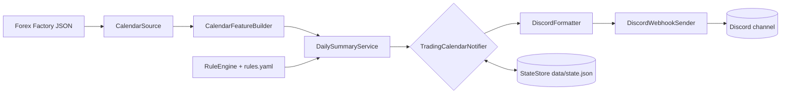

# Optimal Trade Sessions Announcer

Discord webhook announcer that reads the Forex Factory calendar, applies the YAML trading matrix, and posts:

- one morning daily outlook
- one Sunday night weekly outlook
- one same-day NY recheck update only if the calendar meaningfully changed

The app stays calendar-first, currency-scoped (USD by default), and session-based.

## Architecture



Each box is a small module under `bot/`. The `Notifier` orchestrates the schedule, the `RuleEngine` is pure, and `StateStore` keeps idempotency information so the same morning is not posted twice.

## Current behavior

- Pulls Forex Factory calendar events from `ff_calendar_thisweek.json` and `ff_calendar_nextweek.json`
- Separates `Strongest USD news` from `Other red-folder USD news`
- Applies your matrix rules from `config/rules.yaml`
- Treats `no major USD news` days as their own white/caution model
- Distinguishes full USD holidays from partial-holiday / early-close days
- Applies non-core red-news pressure to affected sessions conservatively
- Suppresses duplicate posts across reruns by storing runtime state in `data/state.json`
- Posts trader-style Discord messages through a webhook (with embeds where helpful)
- Falls back to a "red, calendar unavailable" plan if every URL fails

## What it does not do

- No broker integration
- No auto-trading
- No chart scanning
- No intraday buy/sell alerts

## Setup

1. Install Python 3.12+
2. Install dependencies:

   ```bash
   python -m pip install -e '.[dev]'
   ```

3. Copy `.env.example` to `.env` and fill in `DISCORD_WEBHOOK_URL`.
4. Edit:
   - `config/app.yaml`
   - `config/event_aliases.yaml`
   - `config/rules.yaml`
   - `config/messages.yaml` (optional copy/styling)
5. Sanity check by running a dry-run for tomorrow:

   ```bash
   python -m bot --dry-run --target-date 2026-04-17
   ```

6. Run for real once locally:

   ```bash
   python -m bot
   ```

## CLI flags

| Flag | Description |
| ---- | ----------- |
| `--dry-run` | Build messages but do not send a webhook or write state. |
| `--target-date YYYY-MM-DD` | Override the daily/recheck target date. |
| `--force-kind {daily,weekly,recheck}` | Force a specific post kind to run. Use with `--dry-run`. |
| `--config-dir PATH` | Use a non-default config directory (good for staging configs). |
| `--log-level {DEBUG,INFO,WARNING,ERROR}` | Adjust log verbosity. |

## Deployment

A Dockerfile, Procfile, and `railway.json` are included.

```bash
docker build -t trade-sessions-bot .
docker run -e DISCORD_WEBHOOK_URL=... -v "$PWD/data:/app/data" trade-sessions-bot
```

For Railway:

1. Create a service from this repo (Railway picks up the Dockerfile and `railway.json` automatically).
2. Set `DISCORD_WEBHOOK_URL` in the service variables.
3. Attach a [Railway Volume](https://docs.railway.com/reference/volumes) and mount it at `/app/data` so `state.json` survives redeploys. Railway provisions the volume from the dashboard; the Dockerfile intentionally omits a `VOLUME` directive because Railway rejects it.
4. Use the cron schedule documented in `railway.json` (`*/15 * * * *`).

The application internally gates these schedules:

- Morning summary: `09:00 Asia/Tbilisi`
- NY recheck: `08:00 America/New_York`
- Weekly outlook: `21:00 Asia/Tbilisi` on Sunday

A `policy.max_post_age_minutes` value (defaults to 240) prevents the bot from retroactively posting a stale "good morning" note hours later if state was lost.

## Tests, lint, types

```bash
ruff check bot tests
mypy bot
pytest -q
```

CI runs ruff, mypy, vulture, and pytest on push and PR (`.github/workflows/ci.yml`).

## Documentation

- [docs/rules.md](docs/rules.md) — rule schema reference (operators, feature keys).
- [docs/runbook.md](docs/runbook.md) — production runbook (why didn't it post, why did it post twice, how to reset state).
- [CHANGELOG.md](CHANGELOG.md) — release history.
- [CONTRIBUTING.md](CONTRIBUTING.md) — how to add or change rules without touching Python.

## Notes

- `config/app.yaml` defines schedules, calendar URLs, session windows, news-window thresholds, and post-age policy.
- Calendar logic uses `America/New_York`.
- If the calendar source cannot be loaded, the announcer falls back to a red no-trade outlook.
- `data/state.json` is runtime state only and should not be committed.
